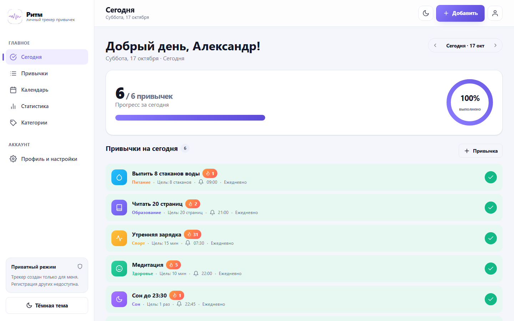
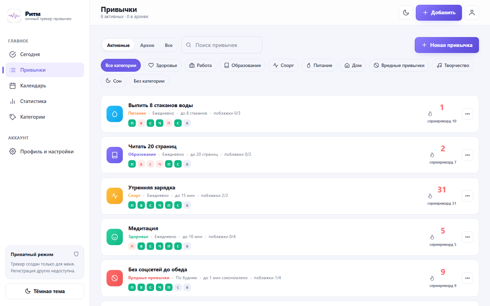
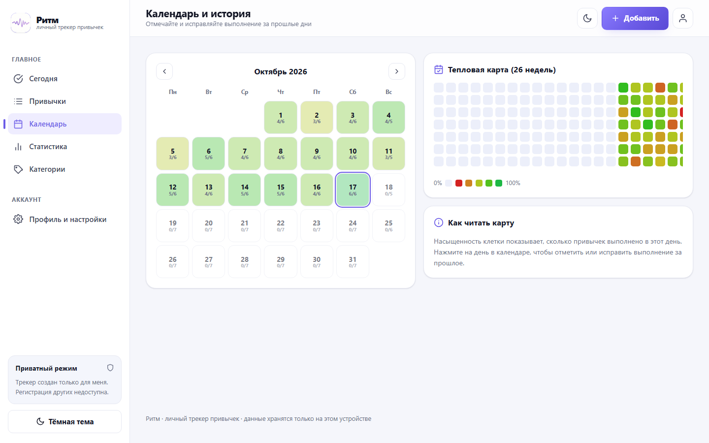
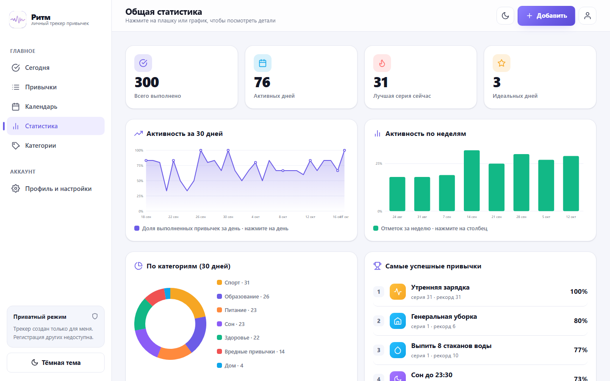
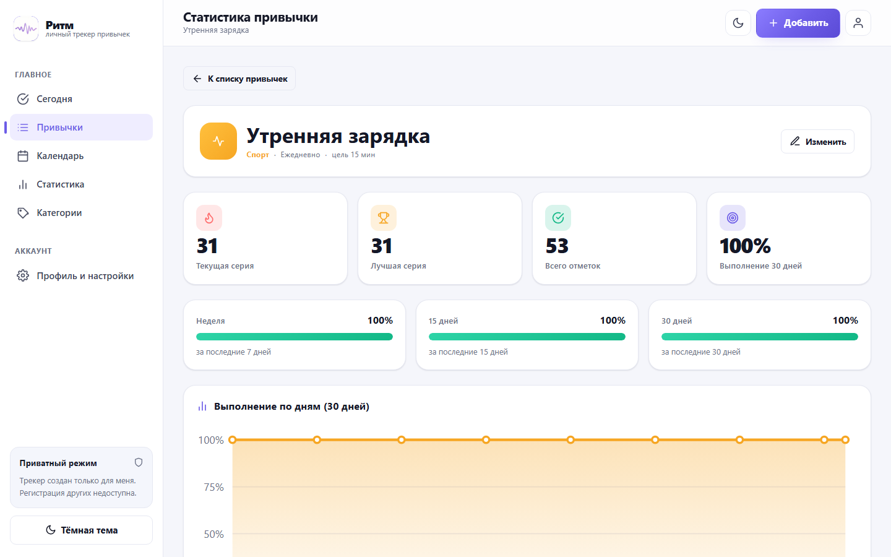
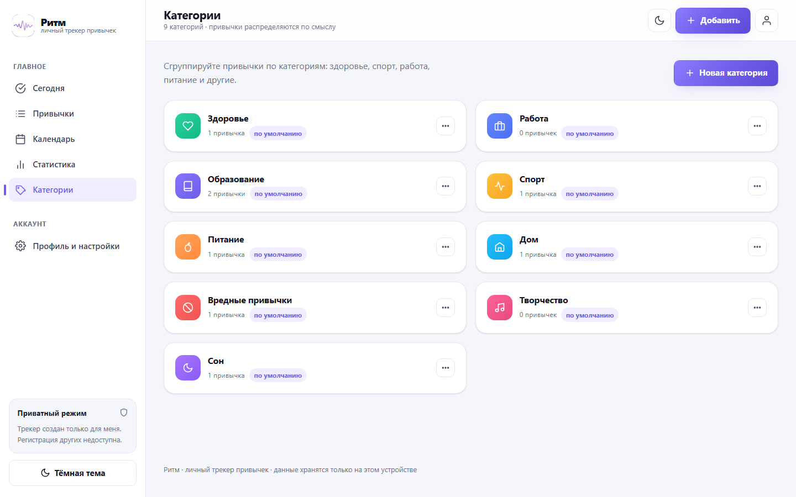
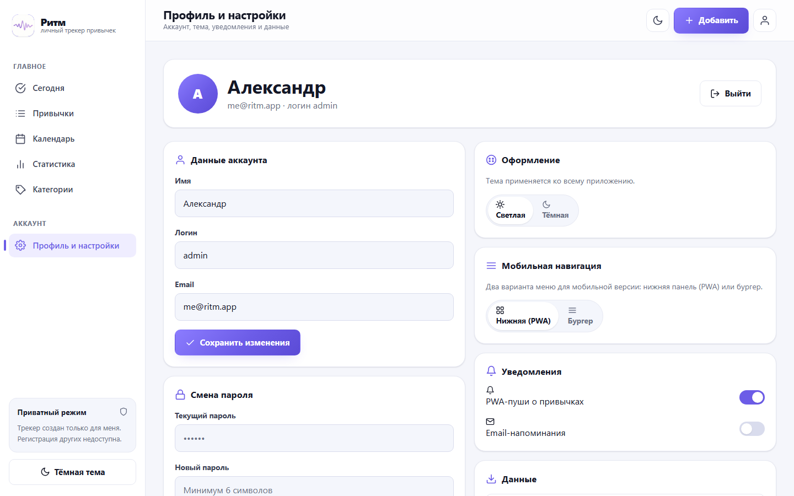
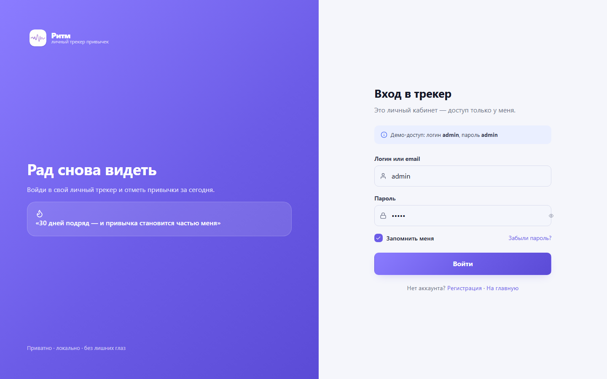

# Ритм — личный трекер привычек

Одностраничное веб-приложение для отслеживания привычек: ежедневные отметки, серии, статистика и календарь. Работает полностью в браузере, данные хранятся локально и никуда не отправляются.


## Возможности

- **Ежедневные отметки** — отметка привычек на сегодня, учёт цели (например, 8 стаканов воды) и частичного прогресса.
- **Серии (streaks)** — подсчёт непрерывных дней и «лучшей серии» по каждой привычке.
- **Частота** — ежедневно, по выбранным дням недели или N раз в неделю.
- **Категории** — готовые и свои категории с иконкой и цветом.
- **Календарь** — месячная сетка и heatmap прогресса, переход к задачам любого дня.
- **Статистика** — сводная и по отдельной привычке: графики (линия, бары, пончик), разбивка по категориям, «лучшая неделя/месяц».
- **Профиль и настройки** — имя пользователя, напоминания, светлая/тёмная тема, два режима навигации (боковое меню и нижняя панель).
- **Приватный вход** — кабинет рассчитан на одного пользователя.
- **PWA** — установка на устройство и офлайн-работа через Service Worker.
- **Хранение данных** — `localStorage`, без бэкенда и аккаунтов.

## Скриншоты

| Сегодня | Привычки |
| --- | --- |
|  |  |

| Календарь и история | Общая статистика |
| --- | --- |
|  |  |

| Статистика привычки | Категории |
| --- | --- |
|  |  |

| Профиль и настройки | Вход |
| --- | --- |
|  |  |

## Технологии

- Чистые HTML, CSS и JavaScript (ES5-совместимый код, IIFE-модули через `window.App`).
- Хэш-роутер собственной реализации, SVG-иконки, графики на SVG.
- Без сборки, без зависимостей, без фреймворков.

## Запуск

Нужен только Node.js (для статического сервера):

```bash
node serve.js
```

Откройте http://localhost:5173

Порт можно изменить переменной окружения `PORT`:

```bash
set PORT=8080 && node serve.js
```

## Демо-доступ

| Логин | Пароль |
| ----- | ------ |
| admin | admin  |

При первом запуске база заполняется демонстрационными привычками и историей за несколько месяцев. Сбросить данные можно кнопкой в разделе «Профиль и настройки».

## Структура проекта

```
index.html              — точка входа, подключение стилей и скриптов
manifest.webmanifest    — манифест PWA
sw.js                   — Service Worker (network-first + офлайн-кэш)
serve.js                — простой статический сервер (Node.js, без зависимостей)
assets/                 — иконки и логотип
css/
  theme.css             — переменные, цвета, тёмная/светлая тема
  layout.css            — каркас приложения (сайдбар, топбар, нижняя навигация)
  components.css        — кнопки, карточки, модалки, формы, тосты
  pages.css             — стили страниц (лендинг, календарь, статистика)
js/
  icons.js              — набор SVG-иконок
  utils.js              — утилиты: даты, модалки, тосты, confirm
  store.js              — состояние, localStorage, сиды, бизнес-логика
  charts.js             — отрисовка графиков на SVG
  components.js         — переиспользуемые компоненты интерфейса
  pages.js              — рендер всех страниц
  router.js             — хэш-роутер
  app.js                — инициализация, глобальная делегация событий, SW
info/                   — ТЗ, исходный логотип
docs/                   — изображения для README
```

## Маршруты

| Хэш | Страница |
| --- | -------- |
| `#/` | Лендинг |
| `#/login`, `#/register`, `#/forgot` | Вход / регистрация / восстановление |
| `#/today`, `#/today/:date` | Привычки на день |
| `#/habits`, `#/habits/new`, `#/habits/:id/edit`, `#/habits/:id/stats` | Привычки и их статистика |
| `#/categories`, `#/categories/new`, `#/categories/:id/edit` | Категории |
| `#/calendar` | Календарь |
| `#/stats` | Общая статистика |
| `#/profile` | Профиль и настройки |
